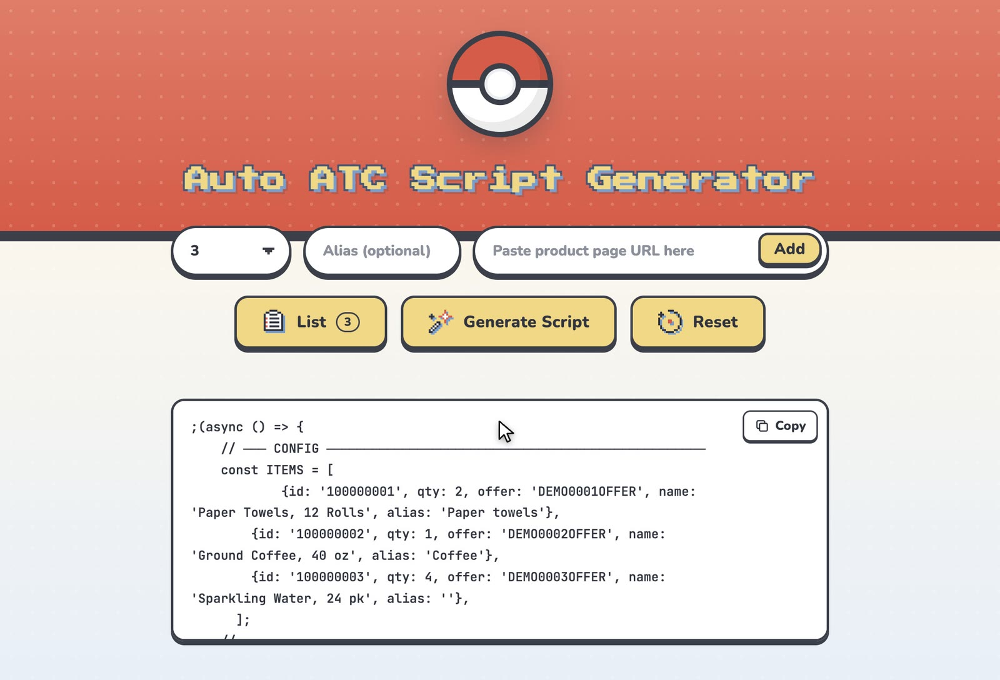

<p align="center">
  
</p>

<h1 align="center">ClubCart</h1>

<p align="center">
  A desktop app that turns a list of Sam's Club product links into one add-to-cart script.<br>
  Paste the links, set a quantity for each, and ClubCart looks up every product and writes a script that adds the whole list to your cart.
</p>

<p align="center">
  
  
  
  
  
  
</p>

<p align="center">
  📖 <a href="https://chrisraiz.github.io/ClubCart/"><b>Documentation &amp; demo</b></a>: a video of the app with sound, how it works, the sound design, and setup.
</p>

<p align="center">
  <a href="https://chrisraiz.github.io/ClubCart/"></a>
</p>

---

> [!IMPORTANT]
> **ClubCart is an independent personal project.**
> It isn't affiliated with, endorsed by, or sponsored by Sam's Club or Walmart. Automating actions on a website can go against its terms of use, so check Sam's Club's terms before using the generated script. See the [Disclaimer](#disclaimer).

---

## Overview

Adding a long shopping list to a Sam's Club cart usually means opening every product page, setting a quantity, and clicking Add to Cart, one item at a time. ClubCart collects the list up front and does the rest:

1. **Add products.** Pick a quantity, optionally type an alias, and paste a product page URL. Only `https` samsclub.com product pages are accepted.
2. **Review the list.** The List dialog shows every item with its alias, URL, and quantity, and lets you remove any of them.
3. **Generate.** ClubCart loads the products one at a time and reads each one's name, item ID, and offer ID from the page's schema.org product data.
4. **Verify, if asked.** If Sam's Club sends a request to its "are you human" check, a window opens so you can complete it. It closes by itself once the product is read, and later lookups reuse the session.
5. **Copy the script.** The output box fills with one script for the whole list. Run it in your browser's console on samsclub.com to add everything to your cart.

---

## Features

### Building the List

- Quantity from 1 to 20 and an optional alias for each item
- URLs checked as you add them: a good one flashes green, and a bad one shakes and shows an error
- Duplicate URLs are skipped
- A List dialog to review items and remove them

### Product Lookup

- Every request runs in the Electron main process, so there are no CORS limits
- Products load one at a time, so at most one verification window is ever open
- A URL that fails is skipped, and the rest of the list still loads
- Live progress on the button and in a status line that screen readers announce

### The Generated Script

- One script for the whole list, with each item's ID, offer ID, quantity, name, and alias
- Up to five attempts per item, checking the cart's quantity after each one
- A ✅ or ❌ result for every item in the console log

### Sound & Motion

- Six sounds (success, error, start, tick, finale, and reset), synthesized with the Web Audio API, so there are no audio files
- Animations for adding, errors, loading, copying, and a full-screen reset
- Respects the system's reduce-motion setting
- The whole interface scales with the window size

---

## Using the Script

1. Sign in at samsclub.com and stay on any page of the site.
2. Open the browser console: <kbd>⌘</kbd> <kbd>⌥</kbd> <kbd>J</kbd> on a Mac, or <kbd>Ctrl</kbd> <kbd>Shift</kbd> <kbd>J</kbd> on Windows (Chrome or Edge).
3. Paste the script and press <kbd>Enter</kbd>. The first time, Chrome may ask you to type `allow pasting`.

```
Starting ATC for 3 items (7 total qty)
▶ ATC Starting for Paper Towels, 12 Rolls
🔁 Attempt 1/5: adding item -> Paper towels
🎯 Target Quantity: 2
🛒 Cart Quantity: 2
✅ Paper towels (100000001) ×2
…
🎉 Done
```

> [!WARNING]
> **Only run scripts you generated yourself.** The script uses your signed-in session to change your cart. ClubCart never sees your password or session, because the script only reads them when you run it in your own browser.

---

## Project Status

| Area                                            | Status                                |
| ----------------------------------------------- | ------------------------------------- |
| Building the list (validation, alias, quantity) | ✅ Implemented                        |
| Product lookup with the verification window     | ✅ Implemented                        |
| Script generation and Copy                      | ✅ Implemented                        |
| Sounds and animations                           | ✅ Implemented                        |
| Custom app icon                                 | ✅ Implemented                        |
| Packaging for macOS, Windows, and Linux         | 🚧 Configured, not signed or notarized |
| Published downloads                             | ❌ Not started                        |
| Automated tests                                 | ❌ Not started                        |

---

## Tech Stack

| Layer       | Technology                                                                  |
| ----------- | --------------------------------------------------------------------------- |
| Desktop app | Electron 44, electron-vite, Electron React Boilerplate                      |
| UI          | React 19, TypeScript, React Router, plain CSS per component                 |
| Sound       | Web Audio API (oscillators, no audio files)                                 |
| Lookup      | Electron `session` fetch on a persistent partition, schema.org product data |
| Packaging   | electron-builder (DMG, NSIS, AppImage)                                      |
| Code style  | ESLint and Prettier                                                         |

---

## Architecture

```
┌────────────────────────┐                     ┌──────────────────────────────┐
│  Renderer (React)      │   window.electron   │  Main process (Electron)     │
│                        │   .getProduct()     │                              │
│  URL list + validation │ ──────────────────► │  1. Check the URL            │      ┌────────────────┐
│  Load one at a time    │       preload       │  2. Fetch on a saved session │ ───► │  samsclub.com  │
│  Script output + Copy  │ ◄────────────────── │     ↳ Bot check? Open a      │      │  product pages │
│                        │  name · SKU · offer │       verification window    │      └────────────────┘
│                        │                     │  3. Read the product         │
└────────────────────────┘                     └──────────────────────────────┘
```

The renderer has no Node.js access. It reaches the main process through one method, `window.electron.getProduct(url, qty, alias)`, exposed by the preload script.

---

## Project Structure

```
.
├── docs/                     # Documentation site (GitHub Pages)
├── src/
│   ├── main/                 # Electron main process
│   │   ├── main.ts           # Window and app lifecycle
│   │   ├── menu.ts           # Application menu
│   │   ├── preload.ts        # The window.electron bridge
│   │   ├── ipc.ts            # The get-product handler
│   │   └── product/          # Lookup, verification window, parser, debug files
│   └── renderer/             # React UI
│       ├── screens/Home/     # The main screen and its state
│       ├── components/       # Header, UrlForm, ListDialog, ActionBar, OutputPanel, icons
│       ├── hooks/            # useUrlList, useCopyToClipboard
│       ├── lib/              # URL validation, product loader, sounds
│       └── styles/           # Theme and global styles
├── assets/                   # App icons and macOS entitlements
├── release/app/              # The packaged app's package.json (build output goes in dist/)
└── .erb/                     # Build and lint tooling
```

---

## Running It Locally

**Requirements:** Node.js 24+ and npm 10+.

```bash
git clone https://github.com/ChrisRaiz/ClubCart.git
cd ClubCart
npm install
npm start
```

| Command            | What it does                                                         |
| ------------------ | -------------------------------------------------------------------- |
| `npm start`        | Runs the app in development with live reload                         |
| `npm run build`    | Builds the main process, preload, and renderer into `release/app/dist` |
| `npm run preview`  | Runs the built app                                                   |
| `npm run package`  | Builds an installable app into `release/build`                       |
| `npm run lint`     | Checks the code with ESLint and Prettier                             |
| `npm run lint:fix` | Fixes what ESLint and Prettier can fix automatically                 |

### Debug Files

Every lookup saves the HTML it read, which helps when a product page changes and parsing stops working. The files go to `debug/` in development, or to the app's user-data folder in a packaged build.

> [!CAUTION]
> **Debug files can contain your account details**, because they're copies of pages you were signed in to. `debug/` is git-ignored so they're never committed. Don't share them.

---

## Disclaimer

ClubCart is an independent personal project. It isn't affiliated with, endorsed by, or sponsored by Sam's Club or Walmart, and "Sam's Club" is used only to describe the site the app works with. Automating actions on a website can go against its terms of use, so check Sam's Club's terms before using the generated script. You use it at your own risk.

## License

Built on [Electron React Boilerplate](https://github.com/electron-react-boilerplate/electron-react-boilerplate) and released under the [MIT License](LICENSE).
